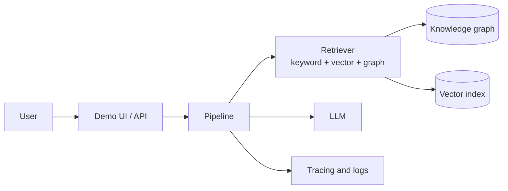

<!--
HOW TO USE THIS TEMPLATE
1. On GitHub, click "Use this template" to create a new repo. Name it after the outcome, not the tech
   (for example `graph-grounded-knowledge-assistant`, not `rag-test`).
2. Replace every <placeholder> below and delete sections that don't apply.
3. Swap `src/app/retrieval.py` and `src/app/llm.py` for your real components. Keep the
   `Pipeline.ask()` interface so the API, demo, tests and evals keep working.
4. Grow `evals/dataset.jsonl`, run `make eval`, and paste the table from `evals/results/results.md`.
5. A project is "shipped" only when the definition-of-done checklist at the bottom is complete.
Delete this comment when you're done.
-->

# <Project name>: <outcome in plain words>

[](https://github.com/<your-username>/<repo>/actions/workflows/ci.yml)


> **<One sentence: who has what problem, and what this project does about it.>**
> Example: *Data stewards spend hours finding who owns a dataset and whether it's fit for use. This assistant answers governance questions from the enterprise knowledge graph and cites its sources.*

**[Live demo](<url>)** · **[3-minute video](<url>)** · **[Write-up](<url>)**


## Results

| Metric | Value | How measured |
| --- | --- | --- |
| Retrieval hit rate | <x%> | Expected source in top 3, <n> questions (`evals/`) |
| Answer correctness | <x%> | <rule-based check / LLM judge / human-labelled sample> |
| Latency p50 / p95 | <x / y ms> | Eval run on <hardware or host> |
| Cost per request | <$x> | <model>, average tokens in and out |

What these numbers mean, and how they changed between versions: <two sentences>.

## Architecture



More detail: [docs/architecture.md](docs/architecture.md).

## Quickstart

```bash
git clone https://github.com/<your-username>/<repo>.git && cd <repo>
make setup        # uv sync + pre-commit hooks
make test         # unit and API tests
make eval         # eval suite, writes evals/results/results.md
make run          # API at http://localhost:8080/docs
make demo         # Streamlit UI
```

Runs offline with no API key by default. To use a real model: `cp .env.example .env`, set `LLM_PROVIDER=anthropic` and your key.

Docker: `docker compose up --build`

## Design decisions and trade-offs

| Decision | Alternatives considered | Why this one |
| --- | --- | --- |
| <e.g. hybrid + graph retrieval> | <vector only> | <multi-hop questions failed with vector only: hit rate x% vs y%> |
| <e.g. model choice> | <bigger model> | <quality vs cost vs latency> |

## Limitations and next steps

- <What it gets wrong, with an example from the evals>
- <What you'd do with more time>

## Data, models and governance

- Data: <public or synthetic source, licence>. No employer or client data is used.
- Model card: [docs/model_card.md](docs/model_card.md) · Data card: [docs/data_card.md](docs/data_card.md) · Governance note: [docs/governance.md](docs/governance.md)
- Weights and large datasets: <Hugging Face Hub link>

## Repository layout

```
src/app/        pipeline, retrieval, LLM client, API
demo/           Streamlit demo
evals/          eval set, runner, results
tests/          unit and API tests
docs/           architecture, cards, governance, write-up
data/           small sample data only (large data lives on Hugging Face Hub)
```

## Definition of done

- [ ] Problem statement, live demo, video and write-up linked above
- [ ] Results table filled from a real eval run
- [ ] Architecture diagram matches the code
- [ ] CI green: lint, tests, evals, Docker build
- [ ] No secrets; `.env.example` complete; secret scanning on in repo settings
- [ ] Model card, data card and governance note written
- [ ] Tagged release (v1.0.0) and CHANGELOG updated
- [ ] Repo description, topics and website link set on GitHub
- [ ] Pinned on profile; LinkedIn post published

## Author

**Arghya Basu**: AI engineer and knowledge-graph architect · [LinkedIn](<url>) · [Portfolio](<url>)

Licensed under the MIT License.
