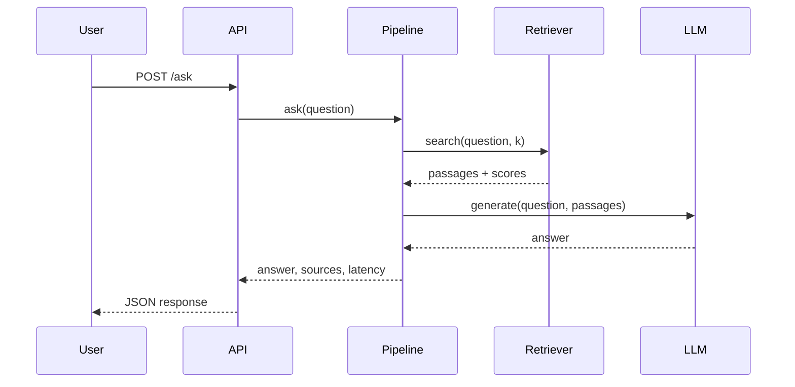

# Architecture

## Context

{Who uses the system, for what, and what systems it touches.}

## Components

| Component | Responsibility | Technology | Notes |
| --- | --- | --- | --- |
| API | Validates requests, returns answers with sources | FastAPI | `src/app/main.py` |
| Pipeline | Orchestrates retrieve, then generate | Python | `src/app/pipeline.py` |
| Retriever | Finds relevant passages and graph facts | {BM25 + vectors + SPARQL/Cypher} | `src/app/retrieval.py` |
| LLM client | Calls the model, with offline fallback | {provider} | `src/app/llm.py` |
| Evals | Measures retrieval and answer quality | Python | `evals/` |

## Request flow

## Key decisions

Record each important decision briefly: context, options, decision, consequences.

## Operations

- Deployment: {Cloud Run / Streamlit Community Cloud / other}, via {CI/CD}
- Monitoring: {logs, traces, cost and latency dashboard}
- Security: secrets in environment variables; input length limits; prompt-injection tests in `evals/`
